  

# 🌐 Awesome Developer Portal & API Management

### 🚀 Curated Directory of Enterprise SaaS & Open-Source Infrastructure

  
  
  
  
  

**A production-ready reference guide for API architects, engineering leads, and DevOps engineers evaluating modern API gateways, developer documentation portals, API lifecycle governance tools, and OpenAPI platforms.**

---

## 📑 Table of Contents

- [📌 Sector Overview & Market Dynamics](#-sector-overview--market-dynamics)
- [☁️ SaaS / Hosted Platforms](#️-saas--hosted-platforms)
- [💻 Open-Source GitHub Projects](#-open-source-github-projects)
- [🛠️ Architectural Guidance & Stack Recipes](#️-architectural-guidance--stack-recipes)
- [🤝 How to Contribute](#-how-to-contribute)
- [💖 Support & Sponsor](#-support--sponsor)
- [📈 Star History](#-star-history)
- [⚖️ Disclaimer](#️-disclaimer)

---

## 📌 Sector Overview & Market Dynamics

The global **API Management Market** is valued between **$8.5 billion and $10.9 billion** (projected to exceed **$35+ billion by 2031** at a compound annual growth rate of ~20%), fueled by the ubiquitous adoption of API-first microservices, multi-cloud architectures, edge computing, and AI-driven API proxying.

Structurally, the sector exhibits **moderate concentration with a consolidated enterprise core surrounded by a highly fragmented open-source and specialized fringe**:
- **The Core Tier (Concentrated):** Hyperscalers and enterprise giants (e.g., Google Apigee, Microsoft Azure API Management, AWS, Salesforce MuleSoft, and Kong) dominate large enterprise multi-million-dollar integration contracts.
- **The Edge Tier (Fragmented):** High innovation velocities, cloud sovereignty requirements, and cost pressures have produced a vibrant, competitive ecosystem of open-source API gateways (e.g., Envoy, Traefik, Apache APISIX, Tyk, KrakenD), developer hubs (Backstage, Scalar), and design-first specification tooling.

---

## ☁️ SaaS / Hosted Platforms

Below is a curated comparison of leading SaaS and managed API management platforms, sorted descending by **company size (market valuation / revenue)**.

| Product | Company Size (Valuation / Revenue) | Description | Starting Pricing | Free Tier / Trial Limits |
|:---|:---|:---|:---|:---|
| **[Apigee (Google Cloud)](https://cloud.google.com/apigee)** | **Valuation: ~$3.5T** (Parent: Alphabet/Google) **Revenue: ~$470B/yr** | Enterprise API management platform featuring high-throughput gateway routing, analytics, developer self-service portal, and monetization. | **$0.50/hour per environment** (~$365/month) + $20 per 1M API calls | **60-day free evaluation** (Apigee evaluation environment with full platform capabilities, plus standard $300 GCP trial credits) |
| **[Postman](https://www.postman.com/)** | **Valuation: $5.6B** **Revenue: ~$313M/yr** | Complete API development environment with workspace collaboration, collections, interactive mock servers, monitors, and Newman CLI. | **$9/month per user** (Solo/Basic billed annually) or $19/user/month (Team) | **Free forever plan**: 1 user seat, unlimited collection runs, up to 3 active mock servers, up to 1,000 cloud API requests/month |
| **[Kong Konnect](https://konghq.com/)** | **Valuation: $2.0B** **Revenue: >$100M ARR** | Cloud-managed API lifecycle control plane orchestrating distributed hybrid and cloud data planes, developer portals, and plugin ecosystems. | **$25/month** (Serverless control plane) or **$500/month** (Dedicated Cloud Gateway control plane with 1M requests) | **30-day free trial**: Full Enterprise functionality, unlimited gateway traffic during trial period, 30 days analytics retention |
| **[SwaggerHub](https://swagger.io/tools/swaggerhub/)** | **Valuation: >$1.8B** (Parent: SmartBear) **Revenue: ~$150M+ ARR** | Standardized OpenAPI (OAS) & AsyncAPI design and documentation platform with centralized governance, style linting, and mocking. | **$64.80/month per user** (Individual/Team plan) | **Free forever plan**: 1 user, public API definitions only, limited domain component libraries (or **14-day free trial** for Team features) |
| **[Stoplight](https://stoplight.io/)** | **Valuation: >$1.8B** (Parent: SmartBear) **Revenue: ~$150M+ ARR** | Design-first API lifecycle platform with visual OpenAPI editor, automated style validation, interactive documentation, and Prism mock servers. | **$44/month** (Basic plan, includes 3 users) | **Free forever plan**: 1 user, 1 active workspace project (or **14-day free trial** for Team workspace features) |
| **[WSO2 API Manager](https://wso2.com/api-manager/)** | **Valuation: ~$600M** (Acquired by EQT) **Revenue: ~$100M+ ARR** | Full-lifecycle API management suite supporting REST, GraphQL, and event-driven APIs with dedicated developer portal and gateway engine. | **$119/month** (Growth plan: up to 10 Managed Interfaces, 10M Gateway Events) | **30-day free trial**: 5 Managed Interfaces, 1M Gateway Events, 1 Developer Portal included, no credit card required |
| **[Gravitee](https://www.gravitee.io/)** | **Valuation: ~$222M** ($125M+ raised) **Revenue: ~$25M+ ARR** | Event-native and REST API management platform with unlimited users on all tiers. Native protocol mediation for Kafka, MQTT, and webhooks. | **$2,500/month** (Planet tier: 1 production + 1 non-production gateway, 1 module, Gold support) | **Free forever (Community Edition)**: Apache 2.0 license, self-hosted at unlimited scale and users (or **14-day hosted Cloud trial**) |
| **[Tyk](https://tyk.io/)** | **Valuation: ~$140M** **Revenue: ~$15M–$18M/yr** | Open-core API management platform offering cloud and self-managed control planes, API developer portal, and analytical dashboard. | **$600/month** (Core entry cloud tier; custom quote for Professional/Enterprise architecture) | **Free forever (Tyk Gateway OSS)**: MPL 2.0 license, unlimited traffic (or **48-hour Tyk Cloud trial** / **30-day Self-Managed trial license**) |
| **[ReadMe](https://readme.com/)** | **Valuation: ~$50M–$100M** **Revenue: ~$8M–$11M ARR** | Interactive developer documentation platform transforming OpenAPI definitions into personalized API reference hubs with live code runners. | **$250/month** (Pro plan billed annually; or $0 Starter) | **Free forever plan (Starter)**: 1 custom domain, full API reference docs, Git sync, MCP server integration (or **14-day Pro trial**) |

---

## 💻 Open-Source GitHub Projects

Below are the top active open-source projects for self-hosted API gateways, internal developer portals (IDPs), and OpenAPI tooling, sorted in descending order by **GitHub Star count** ⭐.

| Open-Source Project | GitHub Stars Badge | Primary Language / License | Core Capabilities & Architecture |
|:---|:---|:---|:---|
| **[Traefik](https://github.com/traefik/traefik)** |  | Go / Apache-2.0 | Cloud-native modern reverse proxy and API gateway that automatically discovers microservice configurations from Docker, Kubernetes, and Consul. |
| **[Kong Gateway (OSS)](https://github.com/Kong/kong)** |  | Lua / Apache-2.0 | The world's most popular open-source API gateway built on OpenResty/Nginx. Extensible via hundreds of community and enterprise Lua/Go/Python/Wasm plugins. |
| **[Backstage](https://github.com/backstage/backstage)** |  | TypeScript / Apache-2.0 | Spotify's open-source framework for building unified Internal Developer Portals (IDPs), software catalogs, and centralized API documentation hubs. |
| **[Envoy](https://github.com/envoyproxy/envoy)** |  | C++ / Apache-2.0 | CNCF graduated high-performance programmable edge and service proxy designed for cloud-native applications and service mesh backbones. |
| **[Apache APISIX](https://github.com/apache/apisix)** |  | Lua / Apache-2.0 | Dynamic, real-time, high-performance API gateway and ingress controller providing dynamic routing, traffic management, and observability. |
| **[Scalar](https://github.com/scalar/scalar)** |  | TypeScript / MIT | Modern offline-first developer portal and interactive API documentation suite built specifically for OpenAPI (3.0/3.1) and Swagger specs. |
| **[Tyk Gateway](https://github.com/TykTechnologies/tyk)** |  | Go / MPL-2.0 | Lightweight, blazing-fast open-source API gateway supporting REST, GraphQL, gRPC, and TCP/UDP traffic with zero vendor lock-in. |
| **[kin-openapi](https://github.com/getkin/kin-openapi)** |  | Go / MIT | Comprehensive Go library for loading, parsing, and validating OpenAPI 3.0 & 3.1 specifications in programmatic developer pipelines. |
| **[KrakenD](https://github.com/krakend/krakend-ce)** |  | Go / Apache-2.0 | Ultra-fast, stateless declarative API gateway that aggregates, transforms, and filters responses from multiple backends without custom code. |
| **[Fusio](https://github.com/apioo/fusio)** |  | PHP / AGPL-3.0 | Open-source API management system that allows building and managing REST APIs, handling auth tokens, and generating developer portal interfaces. |
| **[WSO2 API Manager](https://github.com/wso2/product-apim)** |  | Java / Apache-2.0 | Complete open-source enterprise API management repository providing full control plane, distributed gateway, and self-service developer portal. |
| **[Azure APIM Developer Portal](https://github.com/Azure/api-management-developer-portal)** |  | TypeScript / MIT | Self-hosted, customizable visual developer portal codebase designed for organizations running Microsoft Azure API Management. |
| **[Gravitee API Management](https://github.com/gravitee-io/gravitee-api-management)** |  | Java / Apache-2.0 | Open-core API management repository supporting HTTP and asynchronous event brokers like Apache Kafka, RabbitMQ, and MQTT. |

---

## 🛠️ Architectural Guidance & Stack Recipes

For engineering teams seeking data sovereignty and predictable cost structures without per-request cloud billing, consider these proven open-source compositions:

1. **Enterprise Full Stack**: Deploy **Kong Gateway (OSS)** or **Apache APISIX** for wire-speed ingress routing, paired with **Backstage** or **Scalar** as your self-hosted Developer Portal.
2. **Event-Native Stack**: Combine **Gravitee Community Edition** with **Apache Kafka** to govern both synchronous REST APIs and real-time streaming webhooks under a unified control plane.
3. **Turnkey Open-Source Platform**: Run **WSO2 API Manager** out-of-the-box for a pre-integrated developer portal, publisher console, key validation broker, and gateway without commercial license fees.

---

## 🤝 How to Contribute

Contributions from API architects, maintainers, and community engineers are warmly welcomed! 🌟

1. **Fork the repository** to your personal GitHub account.
2. **Create a descriptive branch** (`git checkout -b feature/add-new-portal-tool`).
3. **Add or edit entries** in `README.md` keeping tabular format, alphabetical consistency, verified pricing/limits, and official links.
4. **Submit a Pull Request** with a brief summary of the added platform or tooling.

---

## 💖 Support & Sponsor

If this curated repository saves your team time, accelerates your architecture decisions, or aids your developer experience initiatives, please consider supporting the project:

- ⭐ **Star this repository** to help others discover it across GitHub.
- 🍴 **Fork and share** with your platform engineering team and API community.
- ☕ **Buy a coffee & sponsor**: Support ongoing research and maintenance via the [GitHub Sponsors Dashboard](https://github.com/sponsors/ishandutta2007).

---

## 📈 Star History

---

## ⚖️ Disclaimer

- This list is a community-curated directory intended strictly for technical reference and architectural evaluation.
- All trademarks, logos, and service names belong to their respective corporate owners.
- SaaS pricing, subscription tiers, and free trial allowances change regularly; verify current terms with respective platform vendors before making commercial procurement commitments.
